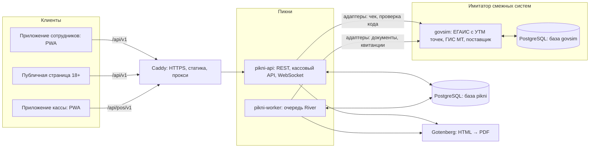
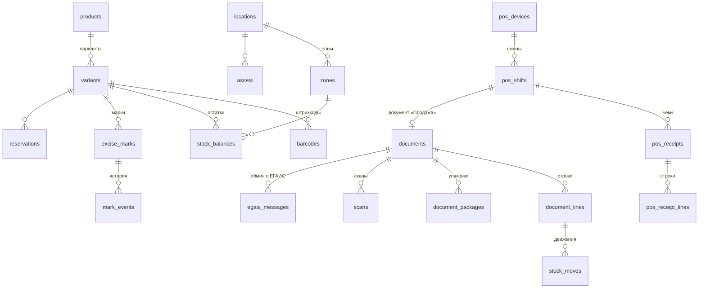
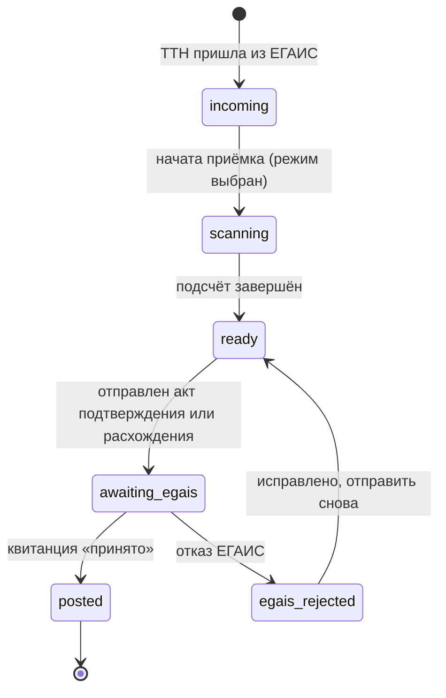
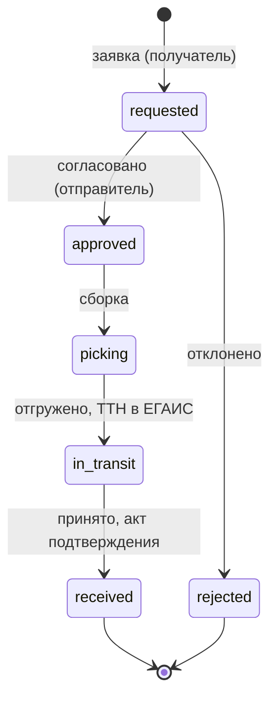
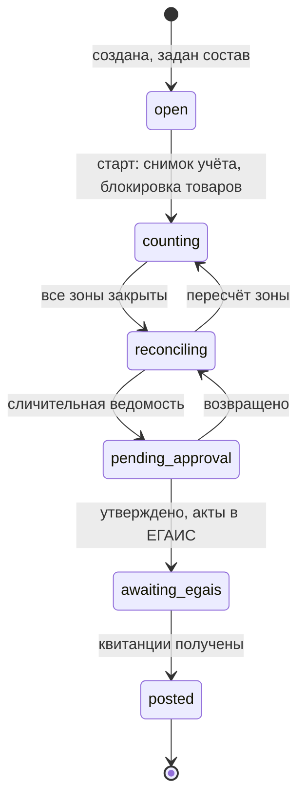
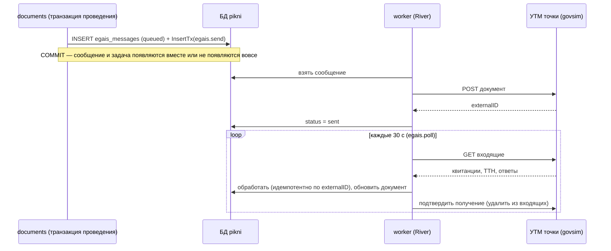

# Проект серверной части АС «Пикни»

Документ детализирует ТЗ ([tz.md](../tz.md)) для серверной части. Ссылки вида СО-1 и КС-2 указывают на требования ТЗ. Имитатор ЕГАИС и «Честного знака» описан отдельно в [govsim.md](govsim.md). Документ служит основой для главы 2 ВКР. После начала разработки источником правды становятся код, `openapi.yaml` и миграции, а этот документ обновляется при изменении решений.

## 1 Архитектура

### 1.1 Общая схема

Сервер «Пикни» — модульный монолит на Go. Из одного модуля `api/` собираются несколько исполняемых файлов, у каждого своя точка входа в `cmd/`:

| Бинарник | Точка входа | Назначение |
|---|---|---|
| `pikni-api` | `cmd/api` | REST API для приложения сотрудников, кассовый API, WebSocket |
| `pikni-worker` | `cmd/worker` | Фоновые и периодические задачи из очереди River, включая обмен с ЕГАИС |
| `pikni-migrate` | `cmd/migrate` | Применение миграций БД (goose и миграции River) |
| `pikni-seed` | `cmd/seed` | Заполнение демонстрационными данными, согласованно с имитатором |

API и обработчик задач — разные процессы в разных контейнерах. Тяжёлая задача не тормозит ответы API, они масштабируются независимо, а обработчик можно вынести на другой сервер. Все бинарники собираются в один образ Docker, поэтому версии API и обработчика всегда совпадают. Это важно: формат задач, которые ставит API, должен понимать обработчик той же версии.

Имитатор `govsim` — отдельная программа со своей базой данных. «Пикни» обращается к нему только по HTTP через адаптеры, как к настоящим внешним системам.



Базы `pikni` и `govsim` живут на одном сервере PostgreSQL, но это разные базы с разными пользователями. «Пикни» не имеет доступа к базе имитатора.

### 1.2 Почему монолит, а не микросервисы

| Критерий | Модульный монолит | Микросервисы |
|---|---|---|
| Согласованность остатков и марок при проведении | Одна транзакция БД | Распределённые транзакции, саги, компенсации |
| Масштаб: 50 пользователей и касс, около 1 млн строк чеков в год | С запасом | Избыточно |
| Развёртывание на одном VPS | Два процесса из одного образа | Десяток контейнеров, сетевые вызовы, отдельный мониторинг |
| Сопровождение командой из одного человека | Просто | Сложно |
| Масштабирование | Несколько экземпляров `serve` | Независимое масштабирование сервисов |

Отдельным сервисом вынесен только имитатор. Он не часть «Пикни», а замена внешним государственным системам, поэтому граница по сети здесь естественна и полезна: она проверяет, что «Пикни» работает с ЕГАИС только через адаптер.

### 1.3 Модули и правила зависимостей

```
api/
  cmd/api, cmd/worker, cmd/migrate, cmd/seed   точки входа бинарников
  internal/
    app/                  конфигурация, сборка зависимостей, запуск
    platform/             инфраструктурный код без бизнес-логики
      db/                 пул pgx, помощник транзакций, повтор при deadlock
      httpx/              настройка Echo, middleware, ошибки RFC 9457, /healthz и /readyz
      logging/            журнал на log/slog (JSON или text)
      queue/              клиент River, регистрация обработчиков
      realtime/           хаб WebSocket, LISTEN/NOTIFY
      pdf/                клиент Gotenberg
      files/              хранилище файлов (каталог на томе)
      clock/, ids/        время (подменяется в тестах), UUIDv7
    auth/                 пароли, сессии, TOTP, вход по QR, ключи касс, проверка прав
    users/                пользователи, привязка к точкам
    locations/            точки, зоны учёта, часы продажи алкоголя
    catalog/              НСИ: позиции, варианты, штрихкоды, справочники, цены, МРЦ, матрица, импорт
    stock/                регистр движений, остатки по зонам, себестоимость, механизм проведения
    marks/                учёт марок ЕГАИС: статус и место каждой марки
    documents/            общий жизненный цикл документов, нумерация, утверждения
      receipt/ floor/ transfer/ sale/ returns/ writeoff/ stocktake/ opening/
    egais/                порт ЕГАИС, клиент имитатора, исходящие и входящие сообщения, сверка
    crpt/                 порт ГИС МТ, клиент имитатора, проверка кодов
    pos/                  кассовый API: кассы, смены, чеки, выгрузка каталога, проверки продажи
    scanning/             приём сканов, идемпотентность, сопряжение устройств
    codes/                распознавание кодов: EAN, марки ЕГАИС, GS1 DataMatrix, упаковки
    reservations/         брони
    assets/               имущество, МОЛ, инвентаризация и списание имущества
    labels/               внутренние EAN-13, ценники, наклейки
    reports/              отчёты, журнал учёта продаж, витрины, экспорт XLSX/PDF
    notifications/        центр уведомлений
    audit/                журнал действий
    integration/          ключи API, справочный API наличия
  db/
    migrations/           SQL-миграции goose
    queries/<модуль>/     SQL-запросы для sqlc
govsim/                   имитатор: отдельный модуль Go, см. govsim.md
openapi/
  pikni.yaml              API приложения сотрудников и публичной страницы
  pos.yaml                кассовый API
```

Внутри бизнес-модуля код делится на три слоя:
- `handler` реализует сгенерированный по OpenAPI интерфейс и переводит HTTP в вызовы сервиса;
- `service` содержит бизнес-логику;
- запросы к БД генерирует sqlc.

Правила:
1. Модуль владеет своими таблицами. Другие модули читают и меняют их только через его сервис.
2. Методы сервиса принимают `db.DBTX`: пул или открытую транзакцию. Так проведение документа вызывает `stock`, `marks`, `egais` и `audit` в одной транзакции, которую открыл модуль `documents`.
3. Циклические зависимости между модулями запрещены, это проверяет линтер. Направление зависимостей: `pos → documents → stock, marks → catalog`; `egais` и `crpt` знают только о своих портах; `audit`, `notifications`, `realtime` — листовые модули.
4. Бизнес-логика не знает про HTTP и Echo.
5. Модули не обращаются к ЕГАИС и ГИС МТ напрямую — только через порты `egais.Gateway` и `crpt.Gateway` (п. 4).

## 2 Модель данных

### 2.1 Общие решения

- **Первичные ключи — UUIDv7.** Они упорядочены по времени, поэтому индексы растут последовательно. Их безопасно показывать в URL, и клиент может создать идентификатор сам: скан и чек в автономном режиме получают ID на устройстве.
- **Время** хранится в `timestamptz` (UTC). Дата документа и смены — местная дата точки. Часовые пояса в формате IANA: Благовещенск — `Asia/Yakutsk` (UTC+9), Хабаровск и Владивосток — `Asia/Vladivostok` (UTC+10). Запрет продажи по времени проверяется по местному времени точки на сервере; время устройства кассы не считается достоверным.
- **Количество** — `integer` (штуки). **Объём тары** — `numeric(6,3)` в литрах. **Деньги** — `numeric(14,2)`, средняя себестоимость — `numeric(14,4)`.
- **Статусы и виды** хранятся в `text` с ограничением `CHECK`. Добавить значение проще, чем в `enum`.
- **Характеристики позиций — JSONB, а не MongoDB.** Набор характеристик зависит от категории: у вина — сорт винограда и год, у коньяка — выдержка, у водки — сырьё. Они лежат в поле `products.attributes` (JSONB), а схема описана в `category_attributes`:
  - сервис проверяет значения по схеме при сохранении;
  - фильтры и подбор аналогов строятся по схеме категории;
  - индекс GIN по `attributes` ускоряет фильтрацию.

  Отдельная документная БД не нужна. Позиции, остатки, марки и документы должны меняться в одной транзакции, а вторая СУБД добавила бы проблему согласованности и ещё один сервис в сопровождении. PostgreSQL даёт гибкость схемы ровно там, где она нужна.
- **Мягкое удаление** для справочников — флаг `is_active`. Документы, движения, чеки и история марок не удаляются никогда.
- **Оптимистическая блокировка** изменяемых сущностей — столбец `version`. При конфликте сервер возвращает 409.

### 2.2 Таблицы

**Безопасность**

| Таблица | Ключевые поля |
|---|---|
| `users` | `login` (уник.), `full_name`, `phone`, `role` (admin, manager, accountant, store_manager, storekeeper, cashier), `password_hash`, `pin_hash` (вход на кассе), `must_change_password`, `totp_secret_enc`, `totp_enabled`, `is_blocked`, `failed_attempts`, `locked_until` |
| `user_locations` | `user_id`, `location_id` — точки пользователя (для ролей с ограничением «Т») |
| `sessions` | `token_hash` (уник.), `user_id`, `pos_device_id` (для сессий кассира), `csrf_token`, `created_at`, `last_seen_at`, `expires_at`, `ip`, `user_agent`, `revoked_at` |
| `one_time_tokens` | `kind` (qr_login, pairing, mfa), `token_hash`, `user_id`, `payload` jsonb, `expires_at`, `used_at` |
| `api_keys` | `name`, `prefix`, `key_hash`, `scopes` text[], `created_by`, `last_used_at`, `revoked_at` |
| `audit_log` | `id` bigserial, `at`, `user_id`, `session_id`, `pos_device_id`, `api_key_id`, `ip`, `action`, `entity_type`, `entity_id`, `data` jsonb |

**Точки и НСИ**

| Таблица | Ключевые поля |
|---|---|
| `locations` | `code` (уник.), `name`, `kind` (warehouse, store), `city`, `address`, `lat`, `lon`, `timezone`, `fsrar_id`, `kpp`, `license_no`, `license_valid_to`, `subject_code` (код субъекта РФ: 28 — Амурская область, 27 — Хабаровский край, 25 — Приморский край), `opening_hours` jsonb, `is_public`, `is_active` |
| `alcohol_sale_rules` | `subject_code`, `valid_from`, `sale_from`, `sale_to` (местное время), `scope` (all — вся алкогольная продукция, strong — крепче 15 %), `source` (закон-основание). Несколько правил на регион — разные `scope` или новые редакции закона; действует правило с наибольшей `valid_from` не позже текущей даты |
| `alcohol_sale_bans` | `subject_code`, `date` или `month_day` (ежегодно), `name` («День знаний»), `scope` — дни полного запрета |
| `zones` | `location_id`, `kind` (warehouse, backroom, floor), `name`. У склада одна зона, у магазина две: склад магазина и торговый зал |
| `suppliers` | `name`, `inn`, `kpp`, `fsrar_id`, `license_no`, `default_receiving_mode` (document, boxes, sample, piece), `contacts` jsonb |
| `categories` | `parent_id` (не меняется после создания), `name`, `depth` (1–3, считает триггер от родителя), `sort`. В архив — только после подкатегорий |
| `category_attributes` | `category_id`, `code`, `name`, `type` (enum, number, text, bool), `options` jsonb (значения списка `{value, archived}`: добавляются и архивируются, не удаляются), `unit` (только у чисел), `filterable`, `used_for_analogs`, `sort` — схема характеристик категории; наследуется подкатегориями. `code` и `type` не меняются, `code` уникален в ветке: у предков и потомков его нет |
| `countries` | `code` (цифровой код ОКСМ), `alpha2`, `name` — только чтение |
| `origin_regions` | `country_code`, `name` — регионы происхождения: Шампань, Коньяк, Кахетия |
| `producers`, `brands` | производитель: `name`, `inn` (для российских), `country_code`; бренд: `producer_id`, `name` |
| `volumes` | `ml` — объёмы тары в миллилитрах для создания вариантов |
| `writeoff_reasons` | `name`, `egais_type` — тип списания в акте ЕГАИС (перечисление TypeWriteOff) |
| `product_kinds` | `code` (код вида продукции НСИ ЕГАИС, 3–5 цифр), `name`, `egais_accounting` (marked — помарочный, quantity — без марок: пиво, сидр, пуаре, медовуха) |
| `product_lines` | `name`, `brand_id` (не меняется) — линейка: позиции одного бренда, различающиеся разновидностью |
| `products` (позиции) | `article` (уник., присваивает база: `ЧК-000001`), `name`, `category_id`, `kind_code` (вид продукции; пусто — без ЕГАИС, способ учёта берётся из вида), `abv` (крепость, обязательна для алкоголя), `crpt_marked` (маркировка «Честным знаком»), `producer_id`, `brand_id`, `product_line_id`, `variety` (подпись разновидности в линейке: «на пшенице», «5 лет»), `country_code`, `origin_region_id`, `attributes` jsonb (характеристики категории, индекс GIN), `version`. Составные внешние ключи проверяют, что бренд — этого производителя, линейка — этого бренда, регион — этой страны. Цены — в `prices` (п. 2.8 плана). Представление `product_cards` добавляет названия связанных записей |
| `product_photos` | `product_id`, `file_key`, `sort` |
| `variants` | `product_id`, `volume_ml` (из справочника объёмов; обязателен для продукции в ЕГАИС), `container` (glass, pet, can), `gift_pack`, `alcocode` (код продукции ЕГАИС, 19 цифр, уник.), `gtin` (14 цифр, уник.); уникальность (`product_id`, `volume_ml`, `container`, `gift_pack`). Объём, тара и упаковка после создания не меняются. Цена варианта — в `prices` (п. 2.8 плана) |
| `barcodes` | `code` (PK), `variant_id`, `kind` (ean13, ean8, upca, code128, internal) — вид определяет сервер, у EAN/UPC проверяется контрольная цифра GS1. Внутренние EAN-13 (ЭТ-1) — префикс 20 и номер из последовательности `internal_barcode_seq` |
| `price_history` | `product_id`, `variant_id`, `price`, `valid_from`, `set_by` |
| `min_retail_prices` | `kind_code`, `abv_from`, `abv_to`, `price_per_litre`, `valid_from` — МРЦ, установленные Минфином России. Упрощение: минимальная цена бутылки = цена за литр × объём тары |
| `assortment_matrix` | `location_id`, `variant_id`, `min_qty` (НСИ-9) |

**Учёт**

| Таблица | Ключевые поля |
|---|---|
| `documents` | `kind`, `number` (уник.), `status`, `doc_date`, `location_id`, `zone_id`, `dest_location_id`, `dest_zone_id`, `supplier_id`, `receiving_mode`, `author_id`, `approved_by`, `approved_at`, `posted_at`, `reversal_of`, `egais_state` (none, pending, accepted, rejected), `scope` jsonb (ревизия), `meta` jsonb, `comment`, `version` |
| `document_lines` | `document_id`, `line_no`, `variant_id` или `asset_id`, `qty_plan`, `qty_fact`, `qty_accepted`, `price`, `cost`, `reason_id` |
| `document_packages` | `document_id`, `code` (штрихкод короба или палеты из ТТН), `parent_code`, `expected` jsonb (марки или строки внутри), `status` (expected, scanned, opened, missing) — для приёмки по коробам и выборочно |
| `document_approvals` | `document_id`, `action` (post, reverse), `requested_by`, `decided_by`, `decision`, `decided_at`, `comment` |
| `doc_counters` | `prefix`, `year`, `last_no` — нумерация без пропусков в транзакции |
| `scans` | `id` (UUID с устройства — ключ идемпотентности), `document_id`, `zone_id`, `user_id`, `device_id`, `source` (camera, wedge, manual, paired), `raw`, `code_kind` (ean, excise_mark, crpt, package, asset), `parsed` jsonb, `variant_id`, `mark_code`, `package_code`, `qty`, `status` (accepted, unknown, foreign, duplicate, rejected), `scanned_at`, `received_at`, `undone_at` |
| `stocktake_zones` | `document_id`, `zone_id`, `name`, `status`, `assigned_to` |
| `stock_moves` (регистр) | `id` bigserial, `document_id`, `line_id`, `variant_id`, `location_id`, `zone_id`, `bucket` (on_hand, in_transit, deficit), `qty` (со знаком), `cost_amount` (со знаком), `doc_date`, `posted_at` |
| `stock_balances` | PK (`variant_id`, `zone_id`), `location_id`, `on_hand`, `reserved`, `in_transit`, `deficit` (п. 3.4), `updated_at` |
| `variant_costs` | `variant_id` (PK), `qty_total`, `avg_cost` |
| `excise_marks` | `code` (PK, нормализованный текст марки), `variant_id`, `alcocode`, `location_id`, `zone_id`, `status` (expected, in_stock, in_transit, reserved, sold, written_off, returned), `package_code`, `last_document_id`, `last_receipt_id`, `updated_at` |
| `mark_events` | `mark_code`, `at`, `kind`, `document_id`, `receipt_id`, `from_status`, `to_status` — история марки (СО-8), только добавление |
| `reservations` | `number`, `variant_id`, `location_id`, `qty`, `mark_code` (отложенная бутылка), `customer_name`, `customer_phone`, `consent_at`, `status` (pending, active, issued, expired, cancelled), `expires_at`, `created_by`, `confirmed_by`, `receipt_id`, `closed_at`, `anonymized_at` |

**Касса**

| Таблица | Ключевые поля |
|---|---|
| `pos_devices` | `location_id`, `name`, `key_prefix`, `key_hash`, `last_seen_at`, `catalog_version`, `revoked_at` |
| `pos_shifts` | `device_id`, `cashier_id`, `number`, `opened_at`, `closed_at`, `status` (open, closed, auto_closed), `totals` jsonb, `sale_document_id` |
| `pos_receipts` | `id` (UUID с кассы — ключ идемпотентности), `shift_id`, `number`, `kind` (sale, return), `return_of`, `created_on_device_at`, `received_at`, `total`, `payment` (cash, card), `age_confirmed`, `egais_qr`, `egais_state`, `reservation_id` |
| `pos_receipt_lines` | `receipt_id`, `line_no`, `variant_id`, `qty`, `price`, `mark_code`, `crpt_code` |

**Обмен с внешними системами**

| Таблица | Ключевые поля |
|---|---|
| `egais_messages` | `id`, `location_id`, `direction` (out, in), `doc_type`, `external_id` (идентификатор в имитаторе), `document_id`, `payload` jsonb, `status` (queued, sent, accepted, rejected, error, processed), `ticket` jsonb, `attempts`, `last_error`, `created_at`, `updated_at` — исходящие и входящие сообщения ЕГАИС |
| `egais_rests_snapshots` | `location_id`, `taken_at`, `payload` jsonb — ответы на запрос остатков для сверки |
| `egais_reconciliation_items` | `snapshot_id`, `variant_id`, `mark_code`, `register`, `ours`, `theirs`, `diff`, `hint` |
| `crpt_checks` | `code`, `checked_at`, `allowed`, `reason`, `expires_at`, `receipt_id` — журнал проверок «Честного знака» |

**Имущество, отчёты, служебное**

| Таблица | Ключевые поля |
|---|---|
| `assets` | `inventory_no` (уник.), `name`, `category`, `serial_no`, `accepted_at`, `cost`, `location_id`, `mol_user_id`, `status`, `photo_key` |
| `asset_events` | `asset_id`, `kind`, `from_location_id`, `to_location_id`, `from_mol_id`, `to_mol_id`, `document_id`, `user_id`, `at`, `comment` |
| `report_runs` | `report_code`, `params` jsonb, `format`, `status`, `file_key`, `error`, `requested_by`, `finished_at`, `expires_at` |
| `notifications` | `user_id`, `kind`, `title`, `body`, `link`, `read_at` |
| `river_*` | таблицы очереди River |
| `mv_*` | материализованные представления для аналитики (п. 6.3) |

### 2.3 Ядро модели



### 2.4 Защита целостности на уровне БД

Ключевые инварианты проверяются ограничениями БД, а не только кодом. Даже ошибка в сервисе не приведёт к отрицательному остатку, двойной продаже марки или правке журнала.

```sql
create table stock_balances (
  variant_id  uuid not null references variants,
  zone_id     uuid not null references zones,
  location_id uuid not null references locations,
  on_hand     integer not null default 0 check (on_hand >= 0),
  reserved    integer not null default 0 check (reserved >= 0),
  in_transit  integer not null default 0 check (in_transit >= 0),
  deficit     integer not null default 0 check (deficit >= 0),
  updated_at  timestamptz not null default now(),
  primary key (variant_id, zone_id),
  check (reserved <= on_hand)
);

-- марка может быть продана только один раз: в строках чеков продажи марка уникальна
create unique index pos_receipt_lines_mark_sold
  on pos_receipt_lines (mark_code) where mark_code is not null and qty > 0;

-- регистр движений, история марок и журнал действий: только добавление
create function forbid_change() returns trigger language plpgsql as $$
begin
  raise exception '% is append-only', tg_table_name;
end $$;
create trigger stock_moves_append_only before update or delete on stock_moves
  for each row execute function forbid_change();
create trigger mark_events_append_only before update or delete on mark_events
  for each row execute function forbid_change();
create trigger audit_log_append_only before update or delete on audit_log
  for each row execute function forbid_change();
```

Строки возврата хранятся с отрицательным `qty`, поэтому уникальный индекс не мешает продать марку повторно после возврата. Приложение подключается к БД под ролью без права `UPDATE` и `DELETE` на эти таблицы. Миграции выполняются под отдельной ролью-владельцем.

## 3 Учёт: проведение документов

### 3.1 Принцип регистра

Любое изменение остатков — строка в `stock_moves`. `stock_balances` — это кеш суммы движений, который обновляется в той же транзакции. Отсюда:
- остаток на дату считается суммой движений до этой даты;
- полная история «кто, когда, каким документом»;
- ежесуточная проверка `sum(stock_moves) = stock_balances` и «число марок in_stock = помарочный остаток» (СО-7);
- отмена документа — новые движения с обратным знаком (сторнирование), а не удаление.

Какие движения создают документы:

| Документ | Движения в «Пикни» | Отражение в ЕГАИС |
|---|---|---|
| Ввод остатков | + on_hand в зоне | сверка с остатками ЕГАИС |
| Поступление | + on_hand на складе (магазина или распределительном); марки → in_stock | акт подтверждения или расхождения по ТТН |
| Передача в зал / из зала | − склад магазина, + торговый зал | для продукции без марок — перевод между регистрами склада и зала |
| Перемещение: отгрузка | − on_hand у отправителя; + in_transit у получателя; марки → in_transit | ТТН от отправителя |
| Перемещение: приёмка | − in_transit; + on_hand на принятое. Недостача остаётся в пути и списывается актом с утверждением | акт подтверждения или расхождения от получателя |
| Продажа (закрытие смены) | − on_hand в торговом зале | чеки с марками уже отправлены при продаже; для пива — акт списания из зала «Реализация» |
| Возврат от покупателя | + on_hand в торговом зале; марка → in_stock | возврат марки на баланс (в имитаторе — чек возврата) |
| Возврат поставщику, списание | − on_hand; марки → returned или written_off | ТТН возврата; акт списания |
| Ревизия (корректировка) | ± on_hand на разницу «факт − учёт» | акты постановки на баланс и списания |

### 3.2 Алгоритм проведения

```
BEGIN (READ COMMITTED)
 1. SELECT документ FOR UPDATE; проверить статус, version и права
 2. проверить, что товары не заблокированы активной ревизией точки
 3. построить список движений по строкам (таблица п. 3.1) и список изменений марок
 4. INSERT ... ON CONFLICT DO NOTHING недостающих строк stock_balances
 5. SELECT stock_balances по всем парам (вариант, зона)
      ORDER BY variant_id, zone_id FOR UPDATE      -- один порядок исключает взаимоблокировки
 6. SELECT excise_marks по маркам документа ORDER BY code FOR UPDATE;
      проверить статус и место каждой марки
 7. проверить достаточность: on_hand − reserved ≥ расход
      (для продаж через кассу — правило п. 3.4)
 8. себестоимость: приход пересчитывает variant_costs, расход берёт avg_cost
 9. INSERT stock_moves; UPDATE stock_balances; UPDATE excise_marks; INSERT mark_events
10. если документ затрагивает ЕГАИС:
      INSERT egais_messages (queued); documents.status = 'awaiting_egais'
    иначе:
      documents.status = 'posted'
11. INSERT audit_log
12. river.InsertTx(...)            -- отправка в ЕГАИС, уведомления, минимальный остаток
13. SELECT pg_notify('pikni_events', ...)   -- доставляется только после COMMIT
COMMIT
```

- При ошибках `40P01` (deadlock) и `40001` (serialization) транзакция повторяется до трёх раз.
- Ограничения из п. 2.4 — последний рубеж: при их срабатывании сервер возвращает 409, а не 500.

**Документы с ЕГАИС проводятся в два шага.** Учёт в «Пикни» меняется сразу, документ получает статус «ожидает ЕГАИС». Когда приходит квитанция:
- **принято** — документ становится проведённым;
- **отказ** — документ получает статус «отклонён ЕГАИС». Пользователь видит причину и решает: исправить и отправить заново или сторнировать.

Так устроено и в реальной рознице: ответ ЕГАИС приходит через минуты, а работать с товаром нужно сразу.

### 3.3 Средняя себестоимость

Средняя взвешенная по организации (ФСБУ 5/2019 допускает оценку по средней себестоимости):

```
при поступлении: avg_new = (qty_total · avg_old + qty_in · price_in) / (qty_total + qty_in)
при выбытии:     cost_out = qty_out · avg_current;  qty_total −= qty_out
перемещение и передача в зал: себестоимость не меняется
```

### 3.4 Продажа при нулевом учётном остатке

**Принятое решение — вариант В («недостача к разбору»).** Товар без марок продаётся через кассу сколько угодно, независимо от учётного остатка, как и в реальной рознице. Расхождение разбирается на ревизии.

Касса не может отказать покупателю, если бутылка физически у него в руках, а учёт считает, что товара нет. Например, недавно ошиблись при приёмке.

- **Продукция с марками.** Проблемы нет: марка либо числится в точке, либо нет. Если не числится, ЕГАИС отклонит чек, и продажа законно невозможна.
- **Пиво и сопутствующие товары.** Есть три варианта:

| Вариант | Как работает | Оценка |
|---|---|---|
| А. Запретить продажу | Касса не пробивает товар, которого нет по учёту | Нереалистично: из-за ошибки учёта теряется продажа, покупатель уходит |
| Б. Разрешить отрицательный остаток | Убрать ограничение `on_hand >= 0` для таких товаров | Просто, так делает 1С с соответствующей настройкой. Но теряется защита БД, а минус в остатке путает отчёты |
| **В. Недостача к разбору (рекомендую)** | При закрытии смены сначала списывается `on_hand` до нуля, остальное записывается в `deficit` с уведомлением управляющему. Ближайшее поступление или передача в зал сначала гасит `deficit`, ревизия закрывает остаток | Ограничение `on_hand >= 0` сохраняется. Расхождение видно явно, в отчёте «Недостачи к разбору» и на дашборде |

Для пива при варианте В в ЕГАИС уходит акт списания «Реализация» на всё проданное количество. Если на регистре зала в ЕГАИС пива не хватает, имитатор отклонит акт, как настоящая ЕГАИС. Управляющий увидит это и проведёт передачу в зал или постановку на баланс. Это реальная ситуация в алкомаркетах, и её стоит показать на защите.

### 3.5 Жизненные циклы документов







У списания, корректировки и сторнирования есть шаг утверждения: `draft → pending_approval → awaiting_egais → posted | rejected`. Утвердить может только другой пользователь с правом `approve` (ПБ-8). Это проверяется в сервисе и закреплено в `document_approvals`.

**Блокировка при ревизии.** У документа ревизии есть `scope`: вся точка, зоны или набор категорий и брендов. Функция БД `stocktake_locked(location_id, variant_id)` проверяет, входит ли товар в состав активной ревизии точки. Её вызывают шаг 2 проведения и проверки кассы.

## 4 Внешние системы: адаптеры ЕГАИС и ГИС МТ

### 4.1 Порты

Бизнес-модули знают только интерфейсы (порты). Реализация для имитатора — один из адаптеров. Адаптер к настоящему УТМ можно добавить, не трогая модули (перспектива).

```go
// egais.Gateway — порт ЕГАИС. Методы относятся к УТМ конкретной точки.
type Gateway interface {
    Send(ctx context.Context, fsrarID string, msg OutMessage) (externalID string, err error)
    Inbox(ctx context.Context, fsrarID string) ([]InMessageRef, error)
    Fetch(ctx context.Context, fsrarID, id string) (InMessage, error)
    Ack(ctx context.Context, fsrarID, id string) error
    SubmitCheque(ctx context.Context, fsrarID string, ch Cheque) (ChequeResult, error) // синхронно, при продаже
    Status(ctx context.Context, fsrarID string) (UTMStatus, error)
}

// crpt.Gateway — порт ГИС МТ «Честный знак».
type Gateway interface {
    CheckCodes(ctx context.Context, codes []string) ([]CodeCheck, error) // разрешительный режим
    ReportSold(ctx context.Context, sale SoldCodes) error                 // в жизни — через ККТ и ОФД
}
```

### 4.2 Асинхронный обмен документами (паттерн transactional outbox)



- **Отправка** повторяется с экспоненциальной задержкой. Если УТМ точки недоступен, сообщения копятся, а на странице «Состояние системы» видна проблема (УВ-2).
- **Входящие** ТТН создают документ «Поступление» в статусе «пришла ТТН» с плановыми строками, марками и упаковками.
- **Журнал обмена.** Каждое сообщение, квитанция и ошибка видны в карточке документа (ИН-3).

### 4.3 Синхронные вызовы при продаже

- **Чек с марками** отправляется в УТМ в момент оплаты (`SubmitCheque`), как в реальной кассе. Ответ содержит QR-код или причину отказа: марка не числится в точке, уже продана, заблокирована. Тайм-аут — 3 с. При недоступности УТМ продажа продукции с марками отклоняется (КС-4).
- **Проверка кода «Честного знака»** (`CheckCodes`) выполняется при добавлении товара в чек. Ответ — «можно» или «нельзя» с причиной: нет в системе, продан, заблокирован, истёк срок годности.

## 5 Кассовый API

Отдельная группа методов `/api/pos/v1` с собственной спецификацией `openapi/pos.yaml`. Приложение кассы пользуется только ей, поэтому так же может подключиться любая другая кассовая программа (КС-6).

### 5.1 Аутентификация

- **Касса** регистрируется администратором (ПБ-4) и получает ключ. Ключ передаётся в заголовке `Authorization: Device pos_<prefix>_<secret>`, в БД хранится хеш.
- **Кассир** входит на зарегистрированной кассе по логину и PIN-коду (4–6 цифр, хеш Argon2id, блокировка после пяти ошибок). Сессия кассира привязана к кассе.
- **Права.** Касса видит только свою точку.

### 5.2 Методы

| Метод | Назначение |
|---|---|
| `POST /session` | Вход кассира по PIN, ответ — сессия и данные точки (часы продажи алкоголя, часовой пояс) |
| `GET /catalog?since=` | Выгрузка каталога по изменениям: варианты, штрихкоды, цены, МРЦ, признаки учёта, удалённые записи. Касса хранит его для автономной работы |
| `GET /time` | Время сервера и окно продажи алкоголя на сегодня |
| `POST /shifts`, `POST /shifts/{id}/close` | Открытие и закрытие смены. Закрытие формирует документ «Продажа» и акт списания пива (КС-5) |
| `POST /checks` | Предварительная проверка позиции перед добавлением в чек (КС-2): марка, код «Честного знака», цена, время, ревизия. Ответ — «можно» или список причин отказа |
| `POST /receipts` | Чек продажи или возврата. Идентификатор задаёт касса, повторная отправка возвращает прежний результат. Для чека с марками сервер синхронно отправляет его в УТМ и возвращает QR-код |
| `GET /receipts/{id}`, `GET /receipts?mark=` | Поиск чека для возврата (КС-3) |
| `GET /reservations?status=active` | Брони точки для выдачи через кассу |

### 5.3 Правила продажи на сервере

Сервер повторяет все проверки КС-2, даже если касса уже проверила. Время берётся серверное в часовом поясе точки, а не с устройства. Отказ возвращается с машинным кодом, по которому касса показывает понятное сообщение, например `sale.alcohol_time_restricted` или `mark.not_on_balance`.

**Автономная работа:**
- Чеки только с товарами без марок и без «Честного знака» касса может пробить без связи и отправить позже: сервер принимает их по идентификатору без дублей.
- Проверку времени для таких чеков сервер выполняет по времени создания на устройстве, скорректированному по последней синхронизации часов.
- Чеки с нарушениями сервер принимает, но помечает и показывает управляющему: товар уже продан, а скрыть нарушение нельзя.

## 6 Безопасность, API, события, задачи, отчёты

### 6.1 Аутентификация и авторизация (ПБ, п. 4.4.8 ТЗ)

- **Пароли** хешируются Argon2id с параметрами не ниже рекомендации OWASP: память 19 МиБ, две итерации, параллелизм 1. Хеш хранится в формате PHC, поэтому параметры можно повысить без сброса паролей.
- **Вход.** После пяти неудачных попыток подряд — блокировка на 15 мин, ограничение частоты по IP — 10 запросов в минуту. Сообщение об ошибке одинаковое для неверного логина и неверного пароля.
- **Второй фактор.** При включённой TOTP вход выдаёт одноразовый `mfa`-токен на 5 мин, затем `POST /auth/mfa`. Секрет TOTP хранится в БД зашифрованным ключом из переменной окружения.
- **Сессия.** Токен — 128 случайных бит (`crypto/rand.Text`), в cookie `pikni_sid` (HttpOnly, Secure, SameSite=Lax, Path=/api), в БД — SHA-256. Срок бездействия 12 ч (отметка последнего обращения обновляется не чаще раза в 5 мин), абсолютный — 7 суток. При смене пароля остальные сессии пользователя завершаются, при сбросе — все.
- **CSRF.** Изменяющие запросы с чужих сайтов отклоняются по `Sec-Fetch-Site` и `Origin` (`http.CrossOriginProtection`), а запросы с сессией дополнительно передают заголовок `X-CSRF-Token`. Токен выдаётся в ответе входа и `GET /auth/me`.
- **Временный пароль.** Пока он не сменён, сервер разрешает только `/auth/me`, `/auth/logout` и `/auth/password`.
- **Вход по QR (ПБ-2):** ПК получает одноразовый токен на 60 с, смартфон открывает `https://…/login/qr#token`, на ПК приходит событие «выполнен вход на устройстве …».
- **Права.** Список прав — перечисление `Permission` в контракте (`receipt.edit`, `pos.sell`, `docs.approve`, `cost.view` и т. п.). Право операции указано в контракте расширением `x-permission` (`authenticated` — достаточно входа); middleware читает его из встроенной спецификации при запуске и проверяет каждый запрос. Таблица «роль → право → охват» в коде повторяет матрицу ТЗ: «+» и «П» — вся сеть, «Т» и «ТП» — свои точки. Сервис получает разрешённые точки через `auth.AllowedLocations(ctx, perm)` (nil — вся сеть) и передаёт их в SQL-фильтр. Закупочная цена и себестоимость убираются из ответа без права `cost.view`. Матрица прав проверяется табличными тестами (П-02). `GET /auth/me` отдаёт фронту права и точки пользователя: по ним строятся меню и выбор точки, но решение о доступе принимает только сервер.
- **Прочее:**
  - только параметризованные SQL-запросы (sqlc);
  - заголовки безопасности выставляет Caddy;
  - в журналах нет персональных данных;
  - данные документа покупателя при проверке возраста не передаются на сервер вовсе: в чеке хранится только отметка `age_confirmed`.

### 6.2 Соглашения REST

- **Адреса:** `/api/v1` — приложение сотрудников; `/api/pos/v1` — касса; `/api/v1/public/…` — справочная страница, без сессии, с ограничением частоты; `/healthz`, `/readyz` — служебные.
- **Ошибки** — в формате RFC 9457 (`application/problem+json`) с машинным кодом и списком нарушений по полям или строкам.
- **Списки:** для таблиц интерфейса — `?page=&per_page=&sort=&filter…` с общим числом строк; для журналов (движения, чеки, аудит) — курсор `?cursor=&limit=`.
- **Повтор запросов.** Создающие запросы принимают `Idempotency-Key`; изменение сущностей требует `version` (иначе 409).

Основные группы методов `/api/v1`:

| Группа | Методы (примеры) |
|---|---|
| auth | `POST /auth/login`, `/auth/mfa`, `/auth/logout`, `GET /auth/me`, `POST /auth/qr`, `/auth/qr/consume`, `GET/DELETE /auth/sessions` |
| users, locations, pos-devices | CRUD, сброс пароля и PIN, блокировка, зоны точки, регистрация и отзыв касс |
| catalog | позиции, варианты, штрихкоды, справочники, МРЦ, матрица; `POST /catalog/import` и `/catalog/import/{id}/commit`; `GET /codes/resolve?code=` |
| documents | `GET /documents?kind=&status=&location=`, `POST /documents`, `GET/PATCH /documents/{id}`; действия `/post`, `/approve`, `/reject`, `/reverse`; приёмка: `/start?mode=`, `/packages/{code}/open`; перемещение: `/approve-request`, `/ship`, `/receive`; ревизия: `/start`, `/zones`, `/reconcile`; `GET /documents/{id}/egais` — журнал обмена |
| marks | `GET /marks/{code}` — статус, место и история марки |
| scans, pairings | `POST /documents/{id}/scans`, `POST /scans/{id}/undo`, `POST /pairings`, `/pairings/join`, `PATCH /pairings/{id}` |
| egais | `POST /egais/reconcile?location=`, `GET /egais/reconciliations/{id}`, `GET /egais/status` |
| availability | `GET /availability/search`, `GET /availability/products/{id}`, `GET /availability/products/{id}/similar?location=` — похожие товары (НЛ-7): варианты позиции, другие разновидности линейки, аналоги того же вида и объёма с ценой ±15 % и совпадающими характеристиками, отмеченными `used_for_analogs`, в наличии в точке |
| reservations, assets, labels | CRUD и действия; `POST /labels/pdf` |
| reports | `GET /reports`, `POST /reports/{code}/run`, `GET /report-runs/{id}`, `GET /report-runs/{id}/file`, `GET /dashboard` |
| notifications, audit, api-keys | списки, отметка о прочтении, выборки, выпуск и отзыв ключей |
| public | `GET /public/availability/search`, `GET /public/availability/products/{id}`, `GET /public/stores` |

### 6.3 События реального времени

- **Подключение.** WebSocket `GET /api/v1/ws` проверяет cookie сессии и `Origin`. Темы: `doc:{id}`, `product:{id}`, `location:{id}`, `shift:{id}`, `user:{id}` (уведомления, сопряжение).
- **Рассылка** через `pg_notify('pikni_events', json)` внутри транзакции. Каждый экземпляр `serve` слушает канал и раздаёт события своим подписчикам. Событие отменённой транзакции не уходит никогда.
- **Размер события.** Полезная нагрузка NOTIFY ограничена 8000 байт, поэтому событие несёт тип и идентификаторы, а данные клиент перезапрашивает. Исключение — `scan.accepted`: оно небольшое и передаётся целиком ради задержки до 1 с.
- **Кто отправляет событие о готовом отчёте.** `worker` о WebSocket ничего не знает, а `api` ничего не знает о `worker`. Оба знают только базу:
  1. `worker` завершает задачу и в той же транзакции записывает результат и вызывает `pg_notify`.
  2. PostgreSQL после фиксации транзакции доставляет уведомление всем экземплярам `api`: каждый держит соединение с `LISTEN pikni_events`.
  3. Экземпляр, у которого есть подписчики на тему, отправляет событие в их WebSocket.
- **Потеря события.** NOTIFY не хранится: если в момент события ни один экземпляр `api` не слушает канал (например, все перезапускаются), событие пропадёт. Это допустимо, потому что событие — только подсказка «перезапроси». Состояние всегда лежит в БД, а клиент после переподключения WebSocket перезапрашивает активные данные, а пока соединения нет — опрашивает сам.

**Почему не отдельный сервис WebSocket и не Kafka:**

| Критерий | PostgreSQL LISTEN/NOTIFY + River (выбрано) | Kafka и отдельный сервис WebSocket |
|---|---|---|
| Поток событий | Десятки в секунду — с большим запасом | Сотни тысяч в секунду |
| Согласованность с данными | Событие и задача фиксируются в той же транзакции, что и данные | Запись в БД и публикация в Kafka не атомарны; нужен outbox и ретранслятор, например Debezium |
| Хранение и повтор событий | Не нужны: состояние в БД | Есть: журнал событий хранится и перечитывается |
| Ресурсы и сопровождение | Ничего нового: та же PostgreSQL | Кластер брокеров (JVM, от 1–2 ГБ), отдельный сервис, мониторинг |
| Когда переходить | — | Много сервисов на разных языках, нужен повтор событий, нагрузка выше возможностей PostgreSQL |

Модуль `platform/realtime` изолирован, поэтому при росте его можно вынести в отдельный сервис, а канал событий заменить на NATS или Kafka, не меняя бизнес-модули.

### 6.4 Фоновые задачи (River)

| Задача | Запуск |
|---|---|
| `egais.send` | из транзакции проведения; повторы с задержкой |
| `egais.poll` | каждые 30 с по каждой точке: входящие ТТН, квитанции, ответы |
| `egais.reconcile` | ежесуточно в 06:00 по времени точки и по запросу (СО-9) |
| `egais.remind_unconfirmed` | ежечасно: ТТН без подтверждения |
| `pos.autoclose_shifts` | каждые 15 мин: смены, открытые дольше 24 ч |
| `report.generate`, `import.catalog`, `import.receipt` | по запросу |
| `notify.min_stock`, `notify.event` | из транзакции проведения |
| `reservations.expire` | каждые 5 мин |
| `marts.refresh` | ежечасно: `mv_sales_daily`, `mv_abc`, `mv_dead_stock`, `mv_matrix_gaps`, `mv_rebalance` |
| `integrity.check` | ежесуточно в 04:00: регистр и остатки, марки и помарочный остаток |
| `pd.anonymize` | ежесуточно |
| `report_files.cleanup` | ежесуточно |
| `demo.reset` | ежесуточно, только в демонстрационном режиме |

Задачи ставятся через `InsertTx` в транзакции бизнес-операции: если операция откатилась, задачи нет.

**Очереди и параллельность.** Задачи разных видов не мешают друг другу:

| Очередь | Задачи | Одновременно на один `worker` |
|---|---|---|
| `egais` | обмен с ЕГАИС и ГИС МТ | 10 |
| `reports` | тяжёлые отчёты, импорт | 2 — чтобы не отнимать процессор у остальных |
| `default` | уведомления, брони, витрины, служебные | 10 |

**Как клиент узнаёт результат.** HTTP-запрос не ждёт выполнения задачи. Сервер ставит задачу, сразу отвечает текущим состоянием («ожидает ЕГАИС», «отчёт формируется») и возвращает клиенту идентификатор. Когда задача завершена, обработчик обновляет данные в БД и шлёт событие через `pg_notify`. Сервер передаёт его по WebSocket всем, кто подписан на документ или пользователя. Клиент перезапрашивает данные. Если WebSocket отключён, клиент опрашивает состояние сам — раз в 3–5 с, пока оно не станет конечным.

**Когда очередь не нужна.** Если пользователь не может продолжить без ответа — например, кассиру нужен QR-код ЕГАИС для чека, — вызов делается синхронно, с тайм-аутом (п. 4.3).

### 6.5 Отчёты и печатные формы

- **Данные.** Отчёты готовят SQL-запросы sqlc: оборотная ведомость — оконные функции по `stock_moves`, журнал учёта продаж — по строкам чеков смен, аналитика — витрины `mv_*`.
- **XLSX** — потоковая запись excelize.
- **PDF** — HTML-шаблоны Go со стилями печати, Gotenberg (`/forms/chromium/convert/html`). Формы ТОРГ-2, ТОРГ-13, ТОРГ-16, ИНВ-3, ИНВ-19 и журнал учёта повторяют структуру утверждённых форм.
- **Штрихкоды** на ценниках генерируются на сервере в SVG.
- **Фоновое формирование.** Отчёт считается тяжёлым, если помечен так или оценка числа строк больше 10 000. Такой отчёт уходит в очередь, пользователь получает уведомление (ОТ-3).

### 6.6 Отказоустойчивость и масштабирование

**Задачи не теряются при падении.** Очередь River хранится в PostgreSQL, а не в памяти процесса:
- задача, поставленная в транзакции, существует, пока не выполнена. Если обработчик упал, задача ждёт в базе, пока какой-нибудь обработчик не поднимется;
- задача, которую обработчик взял и не завершил (процесс упал посреди работы), через заданное время (`RescueStuckJobsAfter`, у нас 5 мин) возвращается в очередь;
- при ошибке задача повторяется с экспоненциальной задержкой, после последней попытки она помечается как отброшенная и видна на странице «Состояние системы».

**Гарантия — «как минимум один раз».** Задача может выполниться повторно, поэтому каждый обработчик идемпотентен:
- `egais.send` проверяет статус сообщения в `egais_messages` и не отправляет уже отправленное. У сообщения постоянный идентификатор, по которому имитатор отбрасывает дубль;
- обработка входящих сообщений идемпотентна по `external_id`;
- уведомление создаётся с ключом уникальности, чтобы не прийти дважды.

**Несколько экземпляров:**
- **`worker`.** Обработчики забирают задачи запросом `SELECT … FOR UPDATE SKIP LOCKED`, поэтому одну задачу берёт ровно один экземпляр. Периодические задачи ставит только ведущий экземпляр (River сам выбирает его через БД и переизбирает при падении).
- **`serve`.** Состояния в памяти нет: сессии в БД, события WebSocket расходятся через LISTEN/NOTIFY. Caddy распределяет запросы между экземплярами. При падении экземпляра WebSocket-клиенты переподключаются к другому и инвалидируют кеш.
- **Запуск:** `docker compose up -d --scale api=2 --scale worker=2` (сценарий П-36).

**Цепочка целиком:**
- лежит сервер — касса копит чеки товаров без марок у себя (КС-4);
- лежит обработчик — сообщения в ЕГАИС копятся в `egais_messages`;
- лежит имитатор — сообщения ждут с повторами.

После восстановления всё догоняется без вмешательства человека.

## 7 Конфигурация, наблюдаемость, тестирование

**Конфигурация** — только переменные окружения:

| Переменная | Назначение |
|---|---|
| `DATABASE_URL`, `DATABASE_MIGRATOR_URL` | Подключение к БД |
| `HTTP_ADDR`, `PUBLIC_URL` | Адрес сервера и внешний адрес |
| `GOTENBERG_URL` | Адрес сервиса PDF |
| `GOVSIM_URL` | Адрес имитатора |
| `FILES_DIR` | Каталог файлов |
| `SECRET_KEY` | Шифрование секретов TOTP |
| `DEMO_MODE` | Демонстрационный режим |
| `SMTP_*` | Почта (2-я очередь) |
| `OTEL_EXPORTER_OTLP_ENDPOINT`, `OTEL_SERVICE_NAME`, `OTEL_TRACES_SAMPLER_ARG` | Наблюдаемость: куда отправлять данные, имя сервиса, доля сохраняемых трассировок |

### 7.1 Наблюдаемость

Сервер и имитатор инструментированы OpenTelemetry — открытым стандартом сбора метрик, журналов и трассировок. Данные уходят по протоколу OTLP в коллектор, а оттуда — в стек Grafana ([infra.md](infra.md), п. 8). Сменить хранилище (например, на коммерческий сервис) можно настройкой коллектора, без изменения кода.

| Сигнал | Откуда | Что видно |
|---|---|---|
| **Трассировки** | официальный middleware Echo v5 (echo-opentelemetry), драйвер pgx (otelpgx), HTTP-клиент адаптеров (otelhttp), задачи River (middleware OpenTelemetry) | Путь запроса: например, `POST /api/pos/v1/receipts` → проверки → SQL-запросы → `SubmitCheque` в имитаторе → `COMMIT`, с длительностью каждого шага. Задача, поставленная из запроса, связана с его трассировкой |
| **Метрики** | те же инструменты + собственные счётчики | Технические: число запросов, ошибки и время ответа по маршрутам, пул соединений БД, очередь River по видам задач. Бизнес-метрики: `pikni_receipts_total`, `pikni_scans_total{result}`, `pikni_egais_queue_size`, `pikni_egais_errors_total`, `pikni_utm_up{location}`, `pikni_deficit_lines`, `pikni_sale_refusals_total{reason}` |
| **Журналы** | `log/slog` в JSON через мост OpenTelemetry | Каждая запись несёт `trace_id` и `span_id`, поэтому из трассировки можно перейти к её журналам и обратно. Плюс `request_id`, `user_id`, `pos_device_id`; персональных данных нет |

Трассировки сохраняются выборочно (на стенде — все, при нагрузочном тесте — 10 %). Ошибочные запросы сохраняются всегда.

**Тестирование:**

| Уровень | Что проверяется |
|---|---|
| Модульные | Распознавание кодов (марки ЕГАИС, GS1, EAN), проверки продажи (время с учётом часового пояса, МРЦ), средняя себестоимость, ABC, правила статусов документов |
| Интеграционные (testcontainers, настоящий PostgreSQL и govsim в контейнере) | Проведение всех видов документов; две параллельные продажи одной марки — проходит одна (П-15); идемпотентность сканов и чеков (П-10, П-14); недостача к разбору; обмен с имитатором, включая отказ и недоступность УТМ; сторнирование; неизменяемость журналов; целостность регистра и марок (П-35); матрица прав (П-02) |
| Контрактные | Ответы сервера проверяются по `pikni.yaml` и `pos.yaml` (kin-openapi) |
| Нагрузочные | k6, сценарии п. 4.4.2 ТЗ, включая поток чеков с касс (П-33); результаты сверяются с метриками в Grafana |
| Отказоустойчивость | Два экземпляра `api` и `worker`, принудительная остановка одного во время потока чеков и приёмки (П-36) |

**Демонстрационные данные** (`pikni-seed`) создаются детерминированно, с фиксированным зерном случайности:
- шесть точек и около 1 800 позиций;
- год истории: поставки, перемещения, около 400 тысяч чеков, бой, ревизии.

Генератор одновременно заполняет имитатор, чтобы остатки и марки в «Пикни» и в имитаторе ЕГАИС совпадали. Несколько расхождений закладываются специально, чтобы показать сверку.
