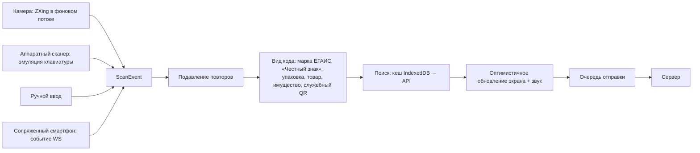

# Проект клиентской части АС «Пикни»

Документ детализирует ТЗ ([tz.md](../tz.md)) для клиентской части. Серверная часть и API описаны в [backend.md](backend.md), фирменный стиль — в [брендбуке](../brand/brandbook.md).

## 1 Архитектура клиента

### 1.1 Два приложения из одного репозитория

| Приложение | Для кого | API | Особенности |
|---|---|---|---|
| `staff` — «Пикни» | сотрудники: управляющие, кладовщики, продавцы, руководство, бухгалтер, администратор | `/api/v1` (`pikni.yaml`) | PWA, автономное сканирование, персонаж и звуки |
| `pos` — касса «Пикни» | продавец-кассир | `/api/pos/v1` (`pos.yaml`) | PWA, автономная продажа товаров без марок, горячие клавиши, печать чека |

**Почему касса — отдельное приложение.** В рознице касса — отдельная программа, а не часть бэк-офиса. Приложение `pos` пользуется только кассовым API, и это доказывает, что любой другой кассе этого API хватит. Кроме того, у кассы своя аутентификация (ключ кассы и PIN кассира) и своя автономная работа, а интерфейс заточен под одну задачу.

**Почему не микрофронтенды.** Они решают задачу нескольких команд, которые независимо выкладывают части одного интерфейса. У нас один разработчик, а общий код удобнее разделить пакетами внутри одного репозитория.

```
web/                          npm workspaces
  apps/
    staff/                    приложение сотрудников
    pos/                      приложение кассы
  packages/
    scanner/                  модуль сканирования (раздел 4)
    api/                      клиенты, сгенерированные из pikni.yaml и pos.yaml; ошибки RFC 9457
    ui/                       тема Vuetify и brand.css из брендбука, общие компоненты, персонаж, звуки
    offline/                  Dexie, очередь отправки, синхронизация справочников
    shared/                   форматирование, часовые пояса, литры и деньги, типы
```

### 1.2 Технологии

| Задача | Средство |
|---|---|
| Фреймворк | Vue 3 (Composition API, `<script setup>`), TypeScript, Vite |
| Компоненты | Vuetify 4 (MIT), иконки MDI; `vite-plugin-vuetify` подключает только используемые компоненты |
| Состояние сервера | TanStack Query: кеш запросов, повторы, инвалидация по событиям WebSocket |
| Состояние приложения | Pinia: текущая точка, связь, сопряжение, смена (в кассе). Сессия (`GET /auth/me`) — данные сервера, поэтому живёт в кеше TanStack Query |
| Маршрутизация | Vue Router, разделы загружаются по требованию |
| Клиент API | Типы генерируются из OpenAPI (openapi-typescript), запросы — openapi-fetch |
| Сканирование | `zxing-wasm`: ZXing-C++ на WebAssembly в фоновом потоке (EAN, UPC, Code 128, QR, DataMatrix, PDF417), решение 0029 |
| Хранилище на устройстве | IndexedDB через Dexie |
| PWA | vite-plugin-pwa (Workbox) |
| Графики, карта | ECharts (vue-echarts), Leaflet + OpenStreetMap |
| Звуки | синтез Web Audio из `packages/ui/sounds` (брендбук, раздел 10) |

**Разделение состояния.** Данные с сервера живут только в кеше TanStack Query, в Pinia их не копируют. Событие WebSocket вида `doc.updated {id}` инвалидирует ключ `['document', id]`, и экран сам перезапрашивает данные.

## 2 Приложение сотрудников (`staff`)

### 2.1 Оболочка

- **ПК** (от 1024 px): боковое меню разделов, верхняя панель с выбором текущей точки, поиском товара, уведомлениями, индикатором связи и УТМ точки, профилем.
- **Скан с любого экрана.** Шапка слушает ручной сканер: скан вне поля ввода открывает «Сканер» с этим кодом (`/scan?code=`). Скан в поле ввода остаётся обычным вводом — так поиск, на котором стоит фокус, получает код.
- **Меню по роли.** Служебные справочники (категории, справочники, правила продажи) в меню у тех, кто их правит; остальным они открываются по ссылке.
- **Смартфон** (до 600 px): нижняя навигация из четырёх разделов (зависят от роли) и крупная кнопка «Пикни!» — сканировать. Остальные разделы в меню «Ещё».
- **Текущая точка.** Пользователь с несколькими точками выбирает текущую: она подставляется в новые документы и выделяется в наличии.
- **Главный экран по ролям.** Пока нет сводок, сотрудники магазина начинают со «Сканера», роли сети — с «Товаров». Дальше:
  - продавец — поиск наличия, передача в зал, брони;
  - кладовщик — пришедшие ТТН, заявки на сборку, ожидающие поступления;
  - управляющий — задачи точки: неподтверждённые ТТН, расхождения с ЕГАИС, недостачи к разбору, незакрытые смены;
  - руководитель — дашборд сети.

### 2.2 Карта маршрутов

| Маршрут | Экран | Требования ТЗ |
|---|---|---|
| `/login`, `/login/mfa`, `/login/qr`, `/change-password` | Вход, второй фактор, вход по QR, смена пароля | ПБ-1 – ПБ-3 |
| `/` | Главный экран по роли / дашборд | ОТ-4 |
| `/scan` | Быстрое сканирование вне документа: товар → карточка наличия с похожими товарами, марка → история марки | СК-9, НЛ-6 |
| `/availability`, `/availability/:productId` | Поиск по сети; таблица «вариант × точка», карта, действия | НЛ-1 – НЛ-3 |
| `/catalog/products`, `/catalog/products/:id` | Номенклатура, карточка позиции с вариантами | НСИ-1, НСИ-2 |
| `/catalog/dictionaries/:kind`, `/catalog/suppliers`, `/catalog/min-prices`, `/catalog/import` | Справочники, поставщики, МРЦ, импорт | НСИ-3 – НСИ-8 |
| `/locations/:id/assortment` | Ассортиментная матрица точки: поиск на сервере, страницы по 50 вариантов, минимальный остаток правится в таблице; в карточке точки — только ссылка с числом вариантов | НСИ-9 |
| `/receiving`, `/receiving/:id` | Пришедшие ТТН; приёмка в выбранном режиме | СО-2 |
| `/floor` | Передача в зал и из зала | СО-3 |
| `/documents`, `/documents/new/:kind`, `/documents/:id` | Журнал документов; карточка документа с журналом обмена с ЕГАИС | СО-1, СО-5, ИН-3 |
| `/transfers` | Заявки на перемещение: входящие, исходящие, в пути | СО-4 |
| `/stocktakes/:id` | Ревизия: зоны, прогресс, помарочное сличение | СО-6 |
| `/marks/:code` | История марки | СО-8 |
| `/egais` | Состояние УТМ точек, сверка с ЕГАИС и её результаты | СО-9 |
| `/shifts`, `/shifts/:id` | Смены и чеки точки (для управляющего) | КС-1, КС-5 |
| `/reservations` | Брони: ожидают подтверждения, активные, история | НЛ-4 |
| `/assets`, `/assets/:id`, `/assets/stocktake/:id` | Имущество, карточка, инвентаризация | ИМ-1 – ИМ-6 |
| `/labels` | Ценники, этикетки, наклейки | ЭТ-2, ЭТ-3, ИМ-2 |
| `/reports`, `/reports/:code`, `/reports/my` | Каталог отчётов, параметры и просмотр, готовые файлы | ОТ-1 – ОТ-3 |
| `/notifications`, `/profile` | Уведомления; профиль: сессии, 2FA, сопряжённые устройства | УВ-2, ПБ-5 |
| `/admin/users`, `/admin/pos-devices`, `/admin/api-keys`, `/admin/audit`, `/admin/system` | Администрирование | ПБ-4, ПБ-7, ИН-2, п. 4.1.5 ТЗ |

Права на маршруты проверяются по ответу `GET /auth/me`. Это только удобство интерфейса, настоящую проверку делает сервер.

### 2.3 Ключевые экраны

**Приёмка ТТН** (смартфон или ПК с сопряжённым смартфоном):
- в шапке поставщик, номер ТТН, режим приёмки, общий прогресс «план / факт»;
- **по коробам и выборочно** — список коробов: «отсканирован», «вскрыть» (система подсвечивает выбранные для выборочной проверки), «вскрыт», «не найден». Скан короба засчитывает содержимое; во вскрытом коробе сканируются марки;
- **поштучно** — окно камеры, крупная карточка последнего скана, список строк с расхождениями сверху;
- чужая марка, недостача и пересорт видны сразу, цветом, словом и звуком;
- кнопка «Подтвердить ТТН» показывает итог: акт подтверждения или акт расхождения со списком расхождений;
- после отправки — статус «ожидает ЕГАИС» и журнал обмена.

**Передача в зал** — быстрый поток: скан товара, количество (по умолчанию 1), следующий скан. Внизу итог по позициям.

**Ревизия:**
- зоны и их прогресс;
- в зоне — сканирование марок и товаров без марок;
- сличение: марки «найдена / не найдена / чужая» и количества «учёт / факт»;
- сводка в штуках и рублях, отправка на утверждение.

**Карточка наличия:**
- фото и основные сведения о позиции: вид, объём, крепость, страна и характеристики категории (например, выдержка или сырьё);
- таблица: строки — варианты, столбцы — точки, сгруппированные по городам. В ячейке «в зале», ниже мелко «склад / резерв / в пути». Своя точка выделена;
- нажатие на ячейку — «Привезти в мою точку» и «Отложить для покупателя»;
- блок «Похожие товары» (НЛ-6) — три горизонтальные ленты карточек: «Другой объём», «Другие разновидности» (той же линейки), «Аналоги в наличии». Фильтры поиска наличия строятся по характеристикам выбранной категории из справочника, поэтому новая характеристика появляется в фильтрах без изменения кода. На карточке фото, объём, цена и наличие «здесь / в сети». Нажатие открывает карточку наличия этого товара;
- ниже — карта точек, где позиция есть.

Карточка наличия открывается из поиска и из скана вне документа (`/scan`). На смартфоне это главный рабочий экран продавца в зале: отсканировал бутылку — увидел, где ещё она есть и чем её заменить.

**Сверка с ЕГАИС:**
- дата снимка;
- три вкладки: склад, зал, марки;
- в строке: наше значение, значение ЕГАИС, разница и подсказка, каким документом устранить, со ссылкой на создание документа.

**История марки** — лента событий: ТТН → приёмка → перемещение → чек или акт, у каждого события документ и сотрудник.

## 3 Приложение кассы (`pos`)

### 3.1 Жизненный цикл

1. **Регистрация кассы.** Администратор создаёт кассу в `staff` (раздел «Кассы») и показывает QR-код со ссылкой `…/pos/#key=…`. Камера планшета открывает по ней кассу уже настроенной; на ПК ключ вставляют вручную. Ключ хранится на устройстве (решение 0040).
2. **Вход кассира** — по логину и PIN на экране с цифровой клавиатурой.
3. **Открытие смены.**
4. **Продажи и возвраты.**
5. **Закрытие смены** — сводный отчёт (КС-1, КС-5).

### 3.2 Экран чека

- **Строка состояния:**
  - точка, касса, кассир, номер смены;
  - связь с сервером и состояние УТМ точки;
  - число неотправленных чеков;
  - обратный отсчёт до конца продажи алкоголя: «Алкоголь ещё 0:45», после 23:00 — «Алкоголь не продаём до 8:00».
- **Слева** — строки чека: позиция, объём, марка или код (сокращённо), цена, количество.
- **Справа** — итог, кнопки «Наличные» и «Карта», ручной поиск товара.
- **Источники скана:**
  - на ПК — аппаратный сканер (эмуляция клавиатуры) или сопряжённый смартфон;
  - на планшете и смартфоне — камера.
- **Проверки при добавлении позиции** (КС-2):
  - марка, код «Честного знака», цена, время и ревизия проверяются запросом `POST /checks`;
  - при первом алкогольном товаре в чеке открывается окно «Покупателю есть 18? Проверьте документ» с кнопками «Да, проверил» и «Нет — убрать алкоголь из чека»;
  - отказ показывается крупно: что нельзя, почему и что делать. Например: «Марка не числится на балансе магазина. Отложите бутылку и сообщите управляющему». Рядом персонаж в подходящем состоянии и звук «пу-у-ум».
- **Оплата имитируется.** После ответа сервера показывается чек: позиции, итог, QR-код ответа ЕГАИС, надпись «Учебный чек. Не является фискальным документом». Чек можно напечатать (стили печати для ленты 58 и 80 мм) или закрыть.
- **Горячие клавиши на ПК:**
  - F2 — поиск;
  - F4 — количество;
  - F8 — удалить строку;
  - F9 — оплата;
  - F10 — возврат;
  - Esc — отмена.

### 3.3 Возврат и брони

- **Возврат:** поиск чека по номеру или скану марки, выбор строк, подтверждение.
- **Выдача брони:** список активных броней точки, выбор брони — позиции попадают в чек и проходят обычные проверки.

### 3.4 Автономная работа (КС-4)

- **Каталог** (варианты, штрихкоды, цены, МРЦ, признаки учёта) хранится в IndexedDB и обновляется по изменениям: `GET /catalog?since=`.
- **Время.** Касса хранит смещение своих часов относительно сервера. Без связи окно продажи алкоголя считается по серверному времени со смещением, а не по часам устройства.
- **Без связи:**
  - товары без марок и без маркировки «Честного знака» продаются, чеки копятся в очереди и отправляются позже без дублей;
  - попытка добавить товар с маркой или кодом «Честного знака» даёт отказ «Нет связи — продажа этого товара невозможна».

## 4 Модуль сканирования (`packages/scanner`)

### 4.1 Источники и конвейер



```ts
interface ScanEvent {
  id: string                // UUIDv7, создаётся на устройстве: ключ идемпотентности
  raw: string               // текст кода, с разделителями GS (0x1D)
  format: 'ean_13' | 'ean_8' | 'upc_a' | 'code_128' | 'qr_code' | 'data_matrix' | 'pdf417'
  source: 'camera' | 'wedge' | 'manual' | 'paired'
  scannedAt: string
}
type CodeKind = 'excise_mark' | 'crpt' | 'package' | 'product' | 'asset' | 'service_qr' | 'unknown'
```

Экран подключает модуль через composable `useScanner(onScan)`: он слушает аппаратный сканер, пока экран открыт, гасит повторы и возвращает `submit` для камеры и ручного ввода и `forget` для отмены скана. Камера — компонент `ScanCamera`: она останавливается, когда вкладка скрыта или экран покинут.

### 4.2 Распознавание вида кода

| Вид | Признаки | Что дальше |
|---|---|---|
| Марка ЕГАИС | PDF417 или DataMatrix без GS1-структуры, характерная длина и алфавит (на стенде — префикс `PKN`) | номер марки ищется в учёте марок |
| Код «Честного знака» | DataMatrix со структурой GS1: `01` + GTIN, `21` + серийный номер, `91`–`93` после GS | GTIN-14 с ведущим нулём приводится к EAN-13, по нему находится вариант |
| Упаковка | Code 128 с идентификатором GS1 `00` (SSCC) или код упаковки из ТТН | содержимое берётся из ТТН |
| Товар | EAN-13, EAN-8, UPC-A с верной контрольной цифрой | поиск варианта |
| Артикул | набран вручную: `ЧК-000001`, без ведущих нулей или в латинской раскладке (`XR-1`) | поиск варианта |
| Имущество | Code 128 или QR с префиксом `INV-` | карточка объекта |
| Служебный QR | ссылка системы (сопряжение, вход, регистрация кассы) | обработка вне документа |

Разбор дублирует серверный: клиент сразу показывает результат, в том числе без связи, но решение принимает сервер.

### 4.3 Камера

Решение 0029.
- **Распознаватель** — ZXing-C++ на WebAssembly, один на всех устройствах. Режим текста Plain сохраняет разделители GS в коде «Честного знака». Модуль (967 КБ, 422 КБ в gzip) раздаёт наш сервер; он загружается только при включении камеры.
- **Поток:** `getUserMedia` с задней камерой, 1920 × 1080 (мелкие DataMatrix марок требуют разрешения), атрибуты `playsinline` и `muted` для iOS.
- **Кадры:** `requestVideoFrameCallback`, не чаще 12 кадров в секунду и один кадр в работе. Область под рамкой с запасом 8 % вырезается в canvas (сторона не больше 1280 пикселей) и уходит в фоновый поток (Web Worker).
- **Рамка видоискателя** — четыре уголка, как на этикетке персонажа. Широкая — для PDF417 и штрихкодов, квадратная — для DataMatrix и QR; переключается кнопкой. Видео показано с `object-fit: cover`, поэтому рамка переводится в пиксели кадра с учётом обрезки (`videoRegion`). Уголки вспыхивают цветом исхода скана.
- **Окно камеры:** 4 : 3 на ПК и квадратное на телефоне, чтобы под ним помещалась карточка скана. На телефоне и планшете камера на экране «Сканер» включена сразу, на ПК — по кнопке; выбор запоминается на устройстве.
- **Фонарик, увеличение, выбор камеры** — через `getCapabilities()` и `applyConstraints`. Кнопка видна, только если устройство это поддерживает. Выбранная камера запоминается; если она пропала, берётся камера по умолчанию.
- **Ошибки** переводятся в понятные сообщения: нет разрешения, камера занята, камеры нет, страница открыта не по HTTPS.
- **Повторы.** Тот же `raw` в течение двух секунд игнорируется, пока код в кадре — окно продлевается.
- **HTTPS обязателен:** камера доступна только в защищённом контексте ([infra.md](infra.md), п. 6).

### 4.4 Аппаратный сканер

Глобальный обработчик `keydown`:
- если интервал между символами меньше 35 мс, длина от шести символов и ввод заканчивается Enter — это скан;
- символы, которые попали в поле ввода, удаляются, и значение поля восстанавливается;
- обычный набор человеком (80–200 мс между символами) сканом не считается (П-19).

Символ GS приводится к 0x1D: разные сканеры передают его как `Ctrl+]` или заменяющий символ из настроек.

### 4.5 Звук и вибрация

Звуки синтезируются в коде по брендбуку, раздел 10 (`packages/ui/src/sounds.ts`, решение 0030):

| Событие | Звук |
|---|---|
| Принято | «ток» |
| Не по плану | «ток-пум» |
| Код не найден | «пум-пум» |
| Стоп: повтор марки, марка не на балансе, продажа запрещена | «пу-у-ум» |
| Документ проведён | «шлёп» |

- **Вибрация** повторяет ритм звука. На iOS вибрации нет, остаются звук и цвет.
- **Цвет всегда дублируется словом и значком.**
- **Звук включается первым касанием или клавишей:** браузер не играет звук без жеста пользователя.
- **Настройки** — громкость, «без звука», «без вибрации» — в профиле, хранятся на устройстве.
- **Отмена скана** убирает его из ленты последних сканов («низкий ток») и снимает код с подавления повторов.

## 5 Автономная работа и связь в приложении сотрудников

- **Подготовка.** При открытии документа сканирования в IndexedDB сохраняются шапка, строки плана, марки и упаковки из ТТН, справочник «штрихкод → вариант» для ассортимента точки. Справочник обновляется по изменениям.
- **Без связи:**
  - скан распознаётся локально и показывается на экране;
  - событие записывается в очередь;
  - в шапке видны «Нет связи», число неотправленных сканов и персонаж в состоянии «нет связи».
- **Отправка** — пакетами по 50 сканов с экспоненциальной задержкой. Повтор безопасен благодаря UUID скана.
- **Конфликт.** Если документ уже закрыт, сервер отклоняет сканы (409). Они остаются в очереди с пометкой, пользователь видит список и решение.
- **Связь с сервером.** Один WebSocket на вкладку. После переподключения активные запросы инвалидируются. Ошибки RFC 9457 переводятся в понятные сообщения по машинному коду. `401` ведёт на вход с возвратом на тот же экран.
- **PWA.** Оболочка кешируется, новая версия ставится в фоне и применяется не посреди сканирования.

## 6 Оформление

Подробно — в брендбуке. Ключевое для разработки:
- **Тема:** `packages/ui` подключает тему и `defaults` из `docs/brand/tokens/vuetify-theme.ts` и `brand.css`:
  - светлая «бумажная» и тёмная «ночная смена»;
  - основной цвет — штемпельная синь, ошибки — сургуч;
  - кнопки без теней, рамки вместо теней.
- **Плотность** — `comfortable` и на ПК, и на смартфоне: пользователь не любит плотные таблицы. Касса — крупнее остальных экранов.
- **Шрифты:** Manrope для интерфейса, JetBrains Mono для марок, штрихкодов, артикулов и количеств; подключаются через `@fontsource`.
- **Статусы** — цвет, значок и слово, в виде штампа (`StatusStamp`).
- **Персонаж-чекушка** появляется в `staff` и `pos`: пустые экраны, успех, ошибки, нет связи, рабочие ситуации (бой, 23:00, паспорт, просрочка, ревизия).
- **Общие компоненты** (`packages/ui`):
  - `StatusStamp`;
  - `QtyCell` — зал, склад, резерв, в пути;
  - `MarkCode` — сокращённая марка с копированием;
  - `MoneyText` и `VolumeText`;
  - `DateText` — с часовым поясом точки;
  - `ServerTable` — обёртка `v-data-table-server` с фильтрами в адресе;
  - `ScanPanel`, `PairingDialog`, `RefusalCard` (отказ с причиной и персонажем), `EmptyState`;
  - `MascotState` — персонаж в нужном состоянии (`accepted`, `breakage`, `night`, `passport`, `expired`, `audit`, `empty`, `offline`, `error`, `idle`) с короткой репликой.
- **Форматирование** через `Intl` (`ru-RU`). Время продажи и даты документов — в часовом поясе точки.
- **Подтверждения** (решение 0034): удаление спрашивает, что пропадёт; изменение показывает «поле — было — станет» в общем окне `ConfirmHost`. Несохранённые правки карточки — на закреплённой панели `UnsavedBar`, уход с ними спрашивает подтверждение.
- **Только чтение.** Без права правки карточка открывается в режиме `readonly`, а не с выключенными серыми полями: значения остаются контрастными.
- **Типографика** — классы Material 3 из Vuetify 4: `text-headline-small`, `text-title-large`, `text-body-medium`, `text-body-small`. Классов Vuetify 2 (`text-h5`, `text-body-2`, `text-caption`) в Vuetify 4 нет: на них текст молча остаётся основного размера.

## 7 Тестирование клиента

| Уровень | Что проверяется |
|---|---|
| Модульные (Vitest) | Распознавание вида кода (марки, GS1, SSCC, EAN), детектор аппаратного сканера, подавление повторов, очередь отправки, расчёт окна продажи алкоголя со смещением часов |
| Компонентные (Vue Test Utils) | `ScanPanel`, `RefusalCard`, таблица наличия, экран чека, окно подтверждения возраста |
| Сквозные (Playwright) | `web/apps/staff/e2e`: запуск — `task e2e` при запущенном `task dev`, в CI — отдельная задача с базой и демо-данными. Тесты идут по собранной версии (`vite build` + `vite preview`): сервер разработки при первом запуске перезагружает страницу. Вход выполняется один раз в global-setup, видео для камеры (Y4M с кодом) рисует тот же ZXing, ffmpeg не нужен. Сценарии П-01 – П-32 ТЗ: приёмка в четырёх режимах, сканирование камерой, касса (время подменяется через `page.clock`, сеть отключается через `context.setOffline`, УТМ выключается через API имитатора), ревизия, наличие, брони. Камера имитируется флагами Chromium `--use-fake-device-for-media-stream --use-file-for-fake-video-capture=<видео .y4m>` с кодами EAN, DataMatrix и PDF417 |
| Доступность и скорость | Lighthouse для главного экрана, приёмки и кассы (ТЗ, п. 7.3) |

Тем же Playwright снимаются скриншоты для ВКР: ширины 1440, 768 и 390 пикселей, светлая и тёмная тема.
