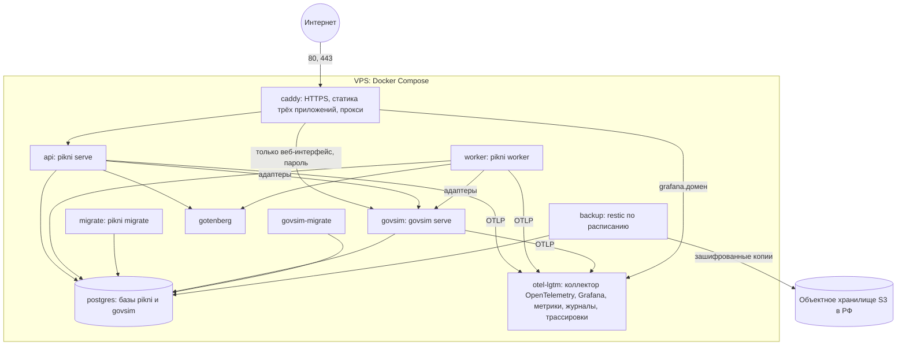
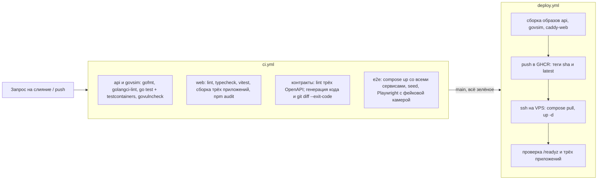

# Проект инфраструктуры АС «Пикни»

Документ детализирует ТЗ ([../../../TZ_sistema.md](../../../TZ_sistema.md)) для развёртывания, сборки и эксплуатации. Компоненты описаны в [backend.md](backend.md), [frontend.md](frontend.md) и [govsim.md](govsim.md).

## 1 Окружения и репозиторий

| Окружение | Где | Назначение |
|---|---|---|
| Локальное | Компьютер разработчика (Windows + Docker Desktop) | Разработка и отладка |
| CI | GitHub Actions | Проверки при каждом изменении, сборка образов |
| Демонстрационный стенд | VPS в РФ | Защита ВКР, приёмочные испытания, опытная эксплуатация |

Монорепозиторий `pikni`:

```
pikni/
  api/              сервер «Пикни» на Go
  govsim/           имитатор ЕГАИС, ГИС МТ и поставщика (отдельный модуль Go)
  web/              приложения staff, pos, public и общие пакеты (npm workspaces)
  openapi/          pikni.yaml, pos.yaml, govsim.yaml — контракты API
  deploy/           compose.yaml, Caddyfile, init-скрипт БД, .env.example, резервное копирование
  docs/             проектные документы, брендбук, схемы, скриншоты, журнал решений
  .github/workflows ci.yml, deploy.yml
  Taskfile.yml      единые команды разработки (go-task работает и в Windows)
```

`govsim.yaml` описывает протокол имитатора. Из него генерируется клиент, который использует адаптер «Пикни». Если имитатор и адаптер разойдутся, проверка в CI упадёт.

## 2 Состав контейнеров



| Сервис | Образ | Особенности |
|---|---|---|
| `caddy` | собственный, на основе `caddy:2`, со встроенными сборками трёх приложений | Единственный, кто открывает порты (80, 443). Автоматические сертификаты Let's Encrypt для каждого поддомена. Сжатие zstd/gzip, заголовки безопасности. Долгий кеш (`immutable`) для файлов с хешем в имени, `no-cache` для `index.html` и сервис-воркера. Для веб-интерфейса имитатора — вход по паролю (`basic_auth`) |
| `api` | собственный: многостадийная сборка Go, финальный слой distroless, запуск не от root | Проверка готовности по `/readyz`, `restart: unless-stopped`, корректная остановка по SIGTERM |
| `worker` | тот же образ, команда `worker` | Без открытых портов |
| `migrate` | тот же образ, команда `migrate` | Одноразовый. `api` и `worker` стартуют после его успешного завершения (`depends_on: service_completed_successfully`) |
| `govsim` | собственный, отдельная сборка из `govsim/`, distroless | API — только во внутренней сети. Веб-интерфейс — через Caddy с паролем |
| `govsim-migrate` | тот же образ, команда `migrate` | Одноразовый, перед `govsim` |
| `postgres` | `postgres` (актуальная основная версия, не ниже 17) | Две базы и два пользователя создаются init-скриптом: `pikni` и `govsim`. У пользователя `pikni` нет доступа к базе `govsim`, и наоборот. Данные на именованном томе, порт наружу не открыт |
| `gotenberg` | `gotenberg/gotenberg:8` | Только во внутренней сети, ограничение памяти 1 ГБ, тайм-аут конвертации |
| `backup` | лёгкий образ с `pg_dump` и `restic` | Ежедневная копия обеих баз и каталога файлов (п. 5) |
| `otel-lgtm` | `grafana/otel-lgtm` | Готовый стек наблюдаемости в одном контейнере: коллектор OpenTelemetry, хранилища метрик (Prometheus), журналов (Loki) и трассировок (Tempo), Grafana с дашбордами и оповещениями. Приём OTLP — только во внутренней сети, Grafana — через Caddy со своим входом (п. 8) |

**Адреса стенда.** Поддомены одного домена, домен выбирается в итерации 2:

| Адрес | Что открывается |
|---|---|
| `app.<домен>` | приложение сотрудников; `/api/v1` проксируется на `api` |
| `pos.<домен>` | приложение кассы; `/api/pos/v1` проксируется на `api` |
| `chekushka.<домен>` | справочная страница наличия; `/api/v1/public` проксируется на `api` |
| `govsim.<домен>` | веб-интерфейс имитатора, с паролем |
| `grafana.<домен>` | дашборды, трассировки, журналы и оповещения, с отдельным входом администратора |

Отдельные поддомены — это отдельные источники (origin) для браузера. Сессия кассира, сессия сотрудника и данные справочной страницы не смешиваются: cookie и хранилища у каждого приложения свои. До покупки домена подойдут адреса вида `app.<ip>.sslip.io`, Caddy получит для них сертификаты.

**Сети:**
- `edge`: caddy ↔ api, caddy ↔ govsim (веб-интерфейс), caddy ↔ otel-lgtm (Grafana);
- `internal`: api, worker, migrate, govsim, govsim-migrate, postgres, gotenberg, backup, otel-lgtm. Эта сеть объявлена `internal: true`.

**Тома:** `pgdata`, `files` (фото, файлы отчётов), `caddy_data` (сертификаты), `backups` (локальный кеш restic), `observability` (данные метрик, журналов и трассировок).

**Журналы** — драйвер Docker `json-file` с ротацией (`max-size: 10m`, `max-file: 5`).

**Бюджет памяти** (VPS 8 ГБ):

| Компонент | Память |
|---|---|
| PostgreSQL | около 1,5 ГБ |
| Стек наблюдаемости (otel-lgtm) | около 1,5 ГБ |
| Gotenberg | до 1 ГБ в пике |
| api + worker (по два экземпляра) | около 400 МБ |
| govsim | около 50 МБ |
| Caddy | около 50 МБ |

Остаток — запас и кеш ОС. С 4 ГБ стек наблюдаемости пришлось бы выключать, поэтому выбран сервер на 8 ГБ.

## 3 Сервер и домен

- **VPS:** 2–4 vCPU, 8 ГБ ОЗУ, 80 ГБ SSD (журналы и трассировки занимают место), Ubuntu LTS, центр обработки данных в РФ (152-ФЗ). Провайдер выбирается в итерации 2 (Timeweb Cloud, Selectel, REG.RU Cloud), у него же — S3-хранилище для резервных копий.
- **Домен.** Варианты на 22.10.2026: `pikni.su`, `pikni.dev` и `pikni.io` свободны; `pikni.ru` занят и выставлен на продажу. Нужны A-записи для поддоменов или одна wildcard-запись `*.<домен>`.
- **Базовая защита сервера:**
  - отдельный пользователь для развёртывания, вход по SSH только по ключу, пароли и root-вход отключены;
  - межсетевой экран: открыты только 22, 80, 443;
  - автоматические обновления безопасности ОС;
  - Docker из официального репозитория.
- **Секреты** лежат в файле `/opt/pikni/.env` (права 600): пароли обеих баз, `SECRET_KEY`, пароль веб-интерфейса имитатора, ключи S3, пароль restic. В репозитории есть только `deploy/.env.example`.

## 4 Сборка и выкладка (GitHub Actions)



- **Контракты.** Если изменился `pikni.yaml`, `pos.yaml` или `govsim.yaml`, а код не перегенерирован, проверка CI падает. Сервер, клиенты и имитатор не могут разойтись.
- **e2e в CI.** Поднимается полный стек вместе с имитатором, загружаются согласованные демонстрационные данные, запускаются сценарии Playwright. Отчёт и скриншоты сохраняются как артефакты.
- **Выкладка:**
  - в `compose.yaml` образы указаны тегом `${IMAGE_TAG}`;
  - откат — повторный запуск с тегом предыдущей версии: `IMAGE_TAG=<sha> docker compose up -d`;
  - миграции пишутся совместимыми с предыдущей версией: «расширить → перенести → сузить».
- **Перерыв в работе при обновлении** — секунды. Обновление запускается вне часов продажи (п. 4.1.4 ТЗ).

## 5 Резервное копирование и восстановление

- **Расписание:** ежедневно в 03:00 по времени Благовещенска (18:00 UTC).
- **Что копируется:** `pg_dump -Fc` обеих баз (`pikni` и `govsim`, в один момент — чтобы они остались согласованными) и каталог `files`. Копия зашифрована, с дедупликацией, отправляется restic в S3.
- **Хранение:** `restic forget --keep-daily 14 --keep-weekly 4 --prune` — 14 ежедневных и четыре еженедельные копии (ТЗ, п. 4.4.9).
- **Контроль:** после копирования выполняется `restic check`. Время и результат последней копии видны на странице «Состояние системы».
- **Восстановление на чистом сервере** (сценарий П-34, цель — не дольше 4 ч):
  1. Создать VPS, установить Docker, скопировать `deploy/` и `.env`.
  2. `restic restore latest` — получить дампы и файлы.
  3. Запустить только `postgres`, выполнить `pg_restore` обеих баз.
  4. `docker compose up -d`, проверить `/readyz`, страницу «Состояние системы» (целостность остатков и марок) и сверку с ЕГАИС.
  5. Переключить DNS, если IP изменился.

Процедура проверяется один раз до защиты, время и результат записываются в протокол испытаний.

## 6 Локальная разработка (Windows)

Нужно установить:
- Docker Desktop (WSL 2);
- Go;
- Node.js LTS;
- Task (go-task);
- mkcert — для HTTPS при проверке камеры с телефона.

| Команда | Действие |
|---|---|
| `task up` | Поднять в Docker postgres (обе базы), gotenberg и govsim |
| `task api` | Запустить сервер «Пикни» с автоперезапуском при изменениях (air) |
| `task web:staff`, `task web:pos`, `task web:public` | Vite dev server нужного приложения; запросы к API проксируются на сервер |
| `task gen` | Сгенерировать код по OpenAPI (oapi-codegen, openapi-typescript) и sqlc |
| `task migrate`, `task seed` | Применить миграции, загрузить согласованные демонстрационные данные в обе базы |
| `task test`, `task e2e` | Тесты сервера, имитатора и клиента; сквозные тесты |
| `task stack` | Полный стек как на сервере (`deploy/compose.yaml`) — проверка сборки перед выкладкой |

**Проверка камеры с телефона в локальной сети.** Vite запускается с HTTPS-сертификатом от mkcert на IP компьютера, корневой сертификат mkcert устанавливается на телефон. Если с сертификатами неудобно, камера проверяется на демонстрационном стенде, где HTTPS настоящий.

## 7 Демонстрационный стенд

- `DEMO_MODE=true`:
  - на странице входа есть кнопки быстрого входа под каждой ролью;
  - для кассы есть заранее зарегистрированная демо-касса в каждом магазине;
  - в шапке плашка «Демонстрационный стенд, данные вымышлены»;
  - отправка почты отключена.
- **Ежесуточный сброс** обеих баз из согласованных «эталонных» дампов, снятых после `seed`.
- **Сценарии для показа** (демо-поставка, «УТМ недоступен», просроченная партия) запускаются из веб-интерфейса имитатора.
- **Справочная страница** «Чекушки» открыта без входа: на ней можно показать сценарий покупателя.

## 8 Наблюдаемость

### 8.1 Состав

- **Инструментирование.** Сервер, обработчик задач и имитатор инструментированы OpenTelemetry ([backend.md](backend.md), п. 7.1) и отправляют трассировки, метрики и журналы по OTLP в контейнер `otel-lgtm`.
- **Хранение и просмотр.** Внутри `otel-lgtm` — коллектор, хранилища (Prometheus — метрики, Loki — журналы, Tempo — трассировки) и Grafana. Это готовая сборка от Grafana Labs, её удобно разворачивать на одном сервере.
- **Почему не Datadog или другой облачный сервис:**
  - сервисы платные, а оплата из России затруднена;
  - журналы и трассировки могут содержать персональные данные, а они не должны уходить за рубеж (152-ФЗ);
  - стандарт OpenTelemetry позволяет перейти на любой сервис настройкой коллектора, без изменения кода.
- **Конфигурация как код.** Дашборды и правила оповещений хранятся в репозитории (`deploy/grafana/`) и загружаются при старте (provisioning). Стенд после пересоздания выглядит так же.
- **Сроки хранения:** метрики — 30 суток, журналы — 14 суток, трассировки — 7 суток (ТЗ, п. 4.3.2).

### 8.2 Дашборды

| Дашборд | Что на нём |
|---|---|
| Обзор | Доступность сервисов, число запросов, доля ошибок, время ответа (95-й процентиль) по группам API, сравнение с ТЗ, п. 4.4.2 |
| Касса и продажи | Чеки в минуту по точкам, отказы продажи по причинам (время, марка, «Честный знак», МРЦ), очереди касс без связи |
| ЕГАИС и ГИС МТ | Доступность УТМ по точкам, очередь `egais_messages` по статусам, время до квитанции, отказы ЕГАИС, проверки кодов |
| Склад | Сканы в минуту, результаты сканов, документы по статусам, недостачи к разбору |
| Платформа | Очередь River по видам задач, повторы и отброшенные задачи, пул соединений и медленные запросы БД, память и CPU контейнеров |

Из любой точки графика можно перейти к трассировкам этого периода, а из трассировки — к её журналам.

### 8.3 Оповещения

Отправляются в Telegram-бот администратора и на почту. Правила хранятся в репозитории.

| Оповещение | Условие |
|---|---|
| УТМ точки недоступен | `pikni_utm_up == 0` дольше 5 мин |
| Много ошибок | доля ответов 5xx выше 1 % за 5 мин |
| Медленно | 95-й процентиль времени ответа выше 300 мс за 10 мин |
| ЕГАИС не успевает | очередь `egais_messages` в статусах queued и sent растёт 15 мин |
| Задачи отброшены | появилась отброшенная задача River |
| Нет резервной копии | последняя успешная копия старше 26 ч |
| Сервис не отвечает | проверка готовности `api` или `govsim` не проходит 2 мин |

### 8.4 Прочее

- Страница администратора «Состояние системы» остаётся: это быстрый взгляд на состояние для управляющего, без входа в Grafana.
- Внешняя проверка доступности главной страницы раз в 5 мин — любым сервисом мониторинга, на случай, если упал сервер целиком вместе с Grafana.

## 9 Масштабирование и почему не Kubernetes

- **Несколько экземпляров.** `api` и `worker` не хранят состояние в памяти, поэтому запускаются в нескольких экземплярах: `docker compose up -d --scale api=2 --scale worker=2`. Caddy находит все экземпляры через DNS Docker (`reverse_proxy` с динамическими адресами `dynamic a api 8080`) и распределяет запросы, а упавший экземпляр исключает по проверке готовности. Задачи распределяются через БД ([backend.md](backend.md), п. 6.6).
- **Kubernetes не используется:**

| Критерий | Docker Compose на VPS | Kubernetes |
|---|---|---|
| Масштаб: один сервер, около десяти контейнеров | Достаточно | Рассчитан на десятки сервисов и узлов |
| Ресурсы | Без накладных расходов | Плоскость управления занимает 1–2 ГБ памяти; управляемый кластер дороже VPS |
| Сопровождение одним человеком | Один файл `compose.yaml` | Манифесты, Helm, сеть кластера, хранилища — отдельная область знаний |
| Отказоустойчивость | Несколько экземпляров на одном сервере, автоматический перезапуск | Перенос между узлами при падении сервера |
| Переход в будущем | Контейнеры без состояния, конфигурация через переменные окружения — готовы к переносу | — |

Вывод для ВКР: оркестратор выбирают под масштаб. Для шести точек и одного сервера достаточно Compose. При росте сети контейнеры переносятся в Kubernetes без переделки кода (ТЗ, п. 4.1.6).
